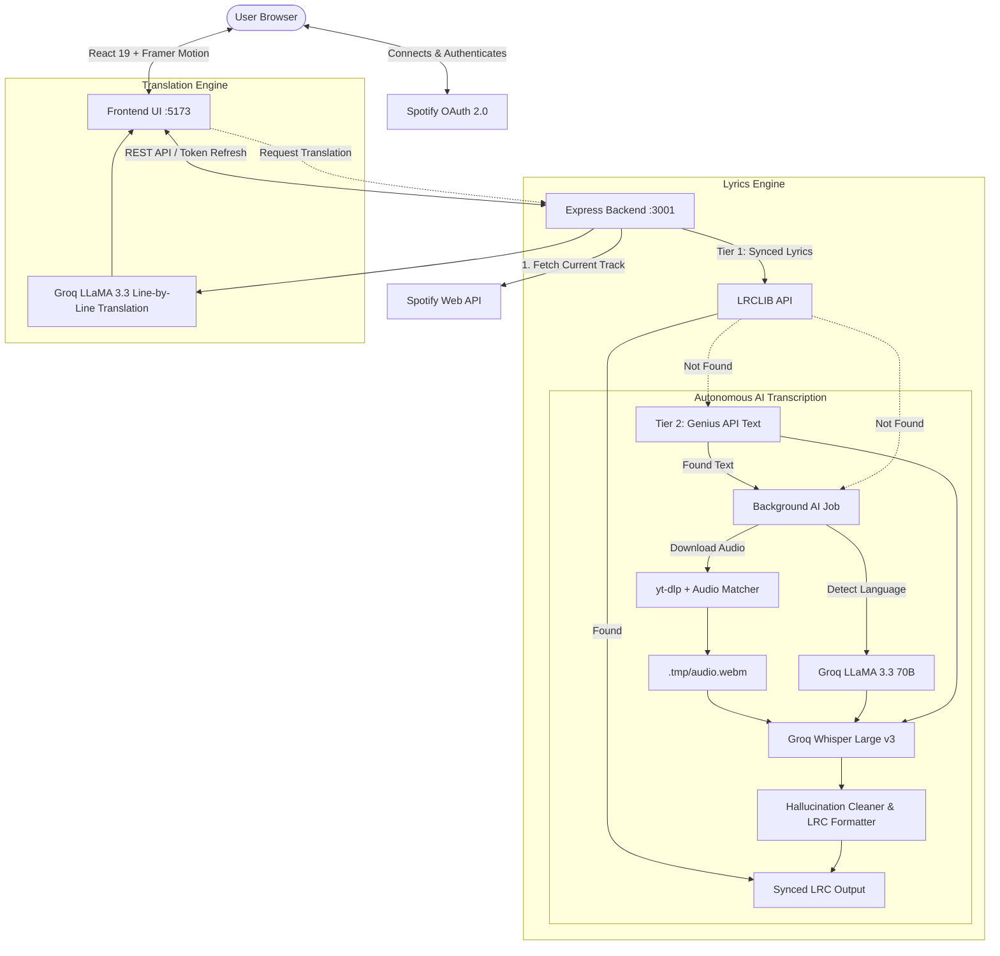

<div align="center">

# Lyrics — Real-Time Synced Karaoke & AI Transcriber

**Live synchronized lyrics for Spotify with multi-tiered automated fallback, Whisper AI audio-to-lyrics transcription, and instant LLaMA 3.3 translation.**

<p align="center">
  <strong>Live Application:</strong> <a href="https://lyricsync-live.vercel.app/">https://lyricsync-live.vercel.app/</a>
</p>

[](https://lyricsync-live.vercel.app/)
[](https://github.com/trxshi747/Lyrics)
[](https://developer.spotify.com/)
[](https://react.dev/)
[](https://vitejs.dev/)
[](https://nodejs.org/)
[](https://groq.com/)
[](https://www.docker.com/)

<br />

<p align="center">
  <a href="https://lyricsync-live.vercel.app/">Live App</a> •
  <a href="#overview">Overview</a> •
  <a href="#features">Features</a> •
  <a href="#system-architecture">Architecture</a> •
  <a href="#tech-stack">Tech Stack</a> •
  <a href="#quick-start">Quick Start</a> •
  <a href="#spotify-developer-configuration">Spotify Setup</a> •
  <a href="#api-reference">API Reference</a> •
  <a href="#docker-deployment">Docker</a> •
  <a href="#repository-structure">Structure</a> •
  <a href="#frequently-asked-questions-faq">FAQ</a>
</p>

</div>

---

## Overview

**Lyrics** turns your Spotify listening experience into an interactive, real-time karaoke screen. Connecting directly to your Spotify account via OAuth 2.0, it automatically tracks whatever song is currently playing on any of your devices, synchronizes lyrics with millisecond precision, and smoothly scrolls through the song in a frosted glass (glassmorphism) interface.

When timed lyrics are missing from standard databases, **Lyrics activates its autonomous AI fallback pipeline**: it pulls the audio from YouTube via `yt-dlp`, runs language detection with **LLaMA 3.3 (70B)**, transcribes timestamps and words using **OpenAI Whisper Large v3** on Groq Cloud, cleans vocal hallucinations, and formats an LRC file on the fly.

---

## Features

- **Live Spotify Playback Synchronization**:
  - Automatically polls your active Spotify player state (`progress_ms`, `is_playing`, track metadata).
  - Dynamically calculates half-round-trip network latency ($RTT / 2$) to offset connection lag.
  - Employs high-frequency (100ms) local linear interpolation to ensure smooth lyric animations between API ticks.

- **3-Tier Multi-Source Lyrics Pipeline**:
  1. **Tier 1 — LRCLIB API**: Instantly queries synchronized community LRC timestamps for thousands of songs.
  2. **Tier 2 — Genius API**: If timed lyrics aren't found, queries Genius for original lyrics text.
  3. **Tier 3 — Autonomous AI Audio Transcription & Sync**:
     - Matches track duration against YouTube/SoundCloud audio using `yt-dlp`.
     - Detects the track's original language using **LLaMA 3.3 70B** to prevent foreign translation drift.
     - Feeds Genius text as guidance prompts into **Whisper Large v3** (Groq) for precision alignment.
     - Filters Whisper AI hallucinations during silent/instrumental sections and marks `[INSTRUMENTAL]` breaks.

- **Professional Context-Aware AI Translation (English and Arabic)**:
  - Powered by **GPT-OSS 120B** on Groq.
  - The model first analyses the whole song (narrator, addressee and gender, dialect, idioms, emotional arc), then translates line by line, keeping refrains consistent and the original timestamps intact.
  - Arabic output is natural Modern Standard Arabic in a poetic register, displayed right-to-left.
  - Language buttons in the player toggle between the original and each translation; results are cached per language.

- **Modern Glassmorphism & Karaoke UI**:
  - Dynamic ambient background glow extracted from the song's album art.
  - Center-focused auto-scrolling with Framer Motion transitions.
  - Interactive scroll override: user can freely scroll through lyrics, with a quick **Re-center (Crosshair)** button to jump back to live playback.
  - Visual status badges (`LRCLIB`, `Genius.com`, `AI Syncing in background`).

- **Spotify Developer Mode Helper**:
  - Responsive in-app modal explaining Spotify's Developer Mode whitelist restrictions and how users can get access.

- **Vercel Analytics Built-in**:
  - Non-intrusive visitor and page view tracking on the frontend.

---

## System Architecture



---

## Tech Stack

| Domain | Technologies & Libraries |
|---|---|
| **Frontend** | React 19, Vite 8, Framer Motion, Lucide Icons, Modern Vanilla CSS (Glassmorphism), Vercel Analytics |
| **Backend** | Node.js (v18+), Express 5, `spotify-web-api-node`, `genius-lyrics`, `axios`, `youtube-dl-exec`, `form-data` |
| **AI / ML** | Groq Cloud API (`whisper-large-v3`, `llama-3.3-70b-versatile`) |
| **Media & Audio** | `yt-dlp`, FFmpeg, Deno |
| **Containerization** | Docker (`node:18-bookworm-slim`), Docker Compose |

---

## Quick Start

### 1. Prerequisites
- **Node.js**: `v18.0.0` or higher ([Download](https://nodejs.org/))
- **Spotify Account**: Spotify Premium is recommended for real-time playback streaming.
- **Spotify Developer App**: Client ID & Client Secret ([Spotify Developer Dashboard](https://developer.spotify.com/dashboard))
- **Groq API Key**: Free API key from [Groq Console](https://console.groq.com/)
- **yt-dlp & FFmpeg**: Required for backend audio downloads (pre-bundled in Docker, or install locally).

### 2. Clone the Repository
```bash
git clone https://github.com/trxshi747/Lyrics.git
cd Lyrics
```

### 3. Configure Environment Variables
Create a `.env` file at the root of the project (refer to `.env.example`):

```env
# Spotify Developer Credentials
SPOTIFY_CLIENT_ID=your_spotify_client_id_here
SPOTIFY_CLIENT_SECRET=your_spotify_client_secret_here
SPOTIFY_REDIRECT_URI=http://localhost:3001/auth/callback

# Groq Cloud API Key (for Whisper and LLaMA 3.3)
GROQ_API_KEY=gsk_your_groq_api_key_here

# Application URLs & Ports
PORT=3001
FRONTEND_URL=http://localhost:5173

# Optional: YouTube cookies to bypass anti-bot blocks on cloud datacenters
# YOUTUBE_COOKIES="your_cookies_text_content"
```

### 4. Install Dependencies

```bash
# Install backend packages
cd backend
npm install

# Install frontend packages
cd ../frontend
npm install
```

### 5. Run Locally

Open two terminal tabs:

**Terminal 1 — Backend:**
```bash
cd backend
node server.js
# Server will start on http://localhost:3001
```

**Terminal 2 — Frontend:**
```bash
cd frontend
npm run dev
# Vite will launch on http://localhost:5173
```

Visit `http://localhost:5173` in your browser, log in with Spotify, and play a song on your Spotify app.

---

## Spotify Developer Configuration

Because this application uses the Spotify Web API in **Development Mode**, follow these steps to configure your credentials:

1. Go to the [Spotify Developer Dashboard](https://developer.spotify.com/dashboard) and log in.
2. Click **Create App**:
   - **App Name**: `Lyrics Player` (or any name you prefer)
   - **App Description**: `Real-time synchronized lyrics viewer`
   - **Redirect URI**: `http://localhost:3001/auth/callback` (for local development) or `https://your-backend-domain.com/auth/callback` (for production)
   - **APIs Used**: Select **Web API**.
3. Under your app settings, copy your **Client ID** and **Client Secret** into your root `.env` file.
4. **Important (User Whitelist)**:
   - Spotify requires all accounts testing development apps to be manually whitelisted.
   - Go to **Settings > User Management**.
   - Add your Spotify account email and the email addresses of any friends testing the app.

---

## API Reference

### Authentication Endpoints

| Method | Endpoint | Description |
|---|---|---|
| `GET` | `/auth/login` | Redirects user to Spotify OAuth 2.0 authorization screen. |
| `GET` | `/auth/callback` | Handles Spotify callback, exchanges code for tokens, redirects to frontend. |
| `POST` | `/auth/refresh` | Refreshes expired Spotify `access_token` using `refresh_token`. |

### Music & Lyrics Endpoints

| Method | Endpoint | Query / Body Params | Description |
|---|---|---|---|
| `GET` | `/api/current-track` | Header: `Authorization: Bearer <token>` | Returns live playing track metadata, progress in ms, and album art. |
| `GET` | `/api/lyrics` | `track_id`, `track_name`, `artist_name`, `duration_ms` | Resolves lyrics via LRCLIB, Genius, or triggers an AI job. |
| `GET` | `/api/lyrics/job` | `track_id` | Checks progress of an in-progress background AI transcription job. |
| `POST` | `/api/translate` | Body: `{ lyricsArray: [...], targetLang: 'en' \| 'ar', trackName?, artistName? }` | Context-aware, line-by-line translation to English or Arabic (right-to-left in the UI) using `openai/gpt-oss-120b` on Groq. |

---

## Docker Deployment

The backend includes a production-ready `Dockerfile` based on Debian Bookworm Slim, pre-configured with:
- Node.js 18
- Python 3 & pip
- FFmpeg (for audio extraction)
- Deno
- The latest master build of `yt-dlp`

### Build and Run with Docker

```bash
# Build backend image
docker build -t lyrics-backend ./backend

# Run container with root .env
docker run -d \
  -p 3001:3001 \
  --env-file .env \
  --name lyrics-api \
  lyrics-backend
```

### Deploying to Cloud Providers
- **Backend**: Can be deployed to [Render](https://render.com), [Railway](https://railway.app), [Fly.io](https://fly.io), or any Docker-compatible VPS.
- **Frontend**: Built and deployed live on Vercel at [https://lyricsync-live.vercel.app/](https://lyricsync-live.vercel.app/). Can also be hosted on [Netlify](https://netlify.com) or [Cloudflare Pages](https://pages.cloudflare.com). Remember to set `VITE_BACKEND_URL` to your live backend domain.

---

## Repository Structure

```text
Lyrics/
├── .env.example             # Template for required environment variables
├── .gitignore               # Ignored cache, dependencies, and environment files
├── README.md                # Project documentation
│
├── backend/
│   ├── Dockerfile           # Production container configuration with FFmpeg & yt-dlp
│   ├── package.json         # Node.js backend dependencies
│   ├── server.js            # Express server, Spotify OAuth, and lyrics routing
│   ├── transcriber.js       # Audio downloader, LLaMA language detection & Whisper transcription
│   └── test_transcriber.js  # Testing utility for transcription engine
│
└── frontend/
    ├── index.html           # HTML entry point with Google Fonts
    ├── package.json         # React 19 & Vite frontend dependencies
    ├── vite.config.js       # Vite build configuration
    └── src/
        ├── App.jsx          # Main application, playback polling, and whitelist modal
        ├── App.css          # Core application styling
        ├── index.css        # Glassmorphism design system, responsive styles & animations
        ├── main.jsx         # React DOM root
        ├── assets/          # Static graphic assets and logos
        └── components/
            └── LyricsView.jsx  # Synced lyrics viewer, auto-scroll, translation toggle
```

---

## Frequently Asked Questions (FAQ)

<details>
<summary><b>1. Why does Spotify login show "User not registered in Developer Dashboard"?</b></summary>
<br>
Spotify requires apps in "Development Mode" to whitelist user emails before they can log in. Go to your Spotify Developer Dashboard > App Settings > User Management, and add the email associated with your Spotify account.
</details>

<details>
<summary><b>2. Do I need Spotify Premium?</b></summary>
<br>
Yes. Spotify's API restricts playback state access (`user-read-playback-state` / `user-read-currently-playing`) primarily to Premium accounts. Free accounts may encounter a 403 Forbidden error from Spotify.
</details>

<details>
<summary><b>3. How accurate is the AI transcription fallback?</b></summary>
<br>
Extremely accurate. The pipeline matches video duration within strict bounds (-15s to +45s) of the Spotify track, detects the original language with LLaMA 3.3 to prevent Whisper from translating foreign words prematurely, and uses the text from Genius as vocabulary guidance for Whisper Large v3.
</details>

<details>
<summary><b>4. What happens when running yt-dlp on cloud hosting (e.g., Render or AWS)?</b></summary>
<br>
Cloud datacenter IPs are frequently rate-limited or blocked by YouTube. To bypass this, export your YouTube browser cookies to a `youtube_cookies.txt` file (or set the `YOUTUBE_COOKIES` environment variable) as supported in <code>transcriber.js</code>.
</details>

---

## License

This project is licensed under the [ISC License](LICENSE).

<div align="center">
  <sub>Built by <a href="https://github.com/trxshi747">trxshi747</a>.</sub>
</div>
